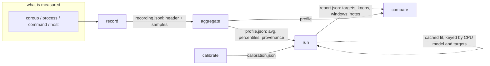
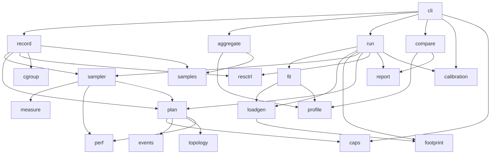
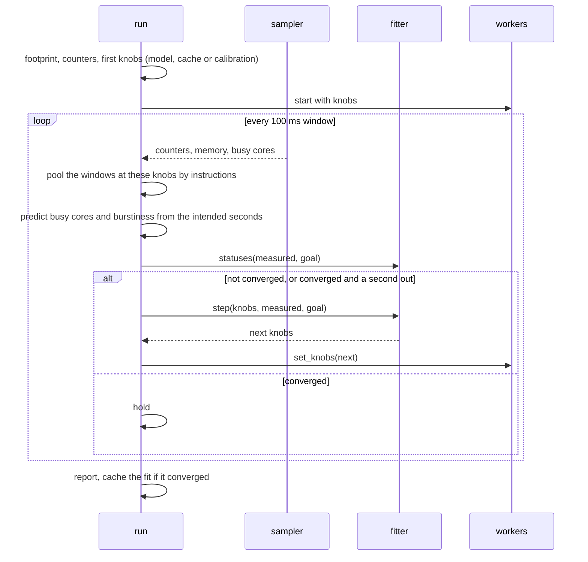
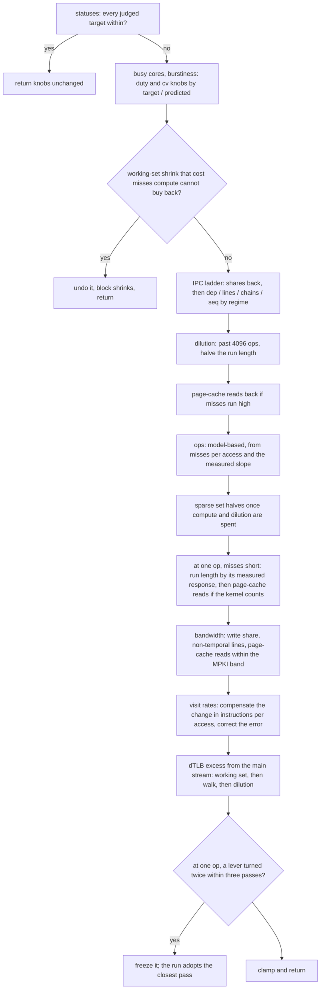

# Architecture

How the pieces fit, for whoever reads the code next. `docs/design.md`
is the contract for what each observable and knob means; this file is
the map. Diagrams are Mermaid.

## 1. Data flow

Three artifacts travel between the commands: a recording, a profile
and a report. Everything else is in memory.

- **record** samples one scope at a fixed interval: counters through
  `perf_event_open`, busy time and memory through cgroup or procfs
  files, DRAM bandwidth through a resctrl monitoring group. Every
  value carries provenance: scope, CPU mode covered, method.
- **aggregate** turns recordings into a profile: per-field averages
  and percentiles over scopes, each scope weighted equally, with the
  busy-cores CV pooled over its windows.
- **run** generates load that is measured the same way, fits its knobs
  to the profile's targets window by window, then holds; the report
  says what was reached at which tier of trust.
- **compare** puts a profile beside a report, a recording or another
  profile, field by field, within a tolerance.

## 2. Modules

| module | owns | depends on |
| --- | --- | --- |
| `cli` | argument parsing, one function per subcommand | everything below; does no measurement itself |
| `record` | the sampling loop for a scope, the stop handler | `sampler`, `plan`, `resctrl`, `cgroup` |
| `aggregate` | recordings to profile, percentiles, pooled CV | `profile`, `samples` |
| `run` | the fit loop: footprint, counters, workers, windows, report | `fit`, `loadgen`, `footprint`, `sampler`, `plan`, `resctrl`, `report`, `calibration` |
| `compare` | field-by-field comparison within a tolerance | `profile`, `report` |
| `fit` | the fitter's rules, pure functions of the last window | `loadgen` (knobs), `profile` (targets) |
| `loadgen` | worker threads, the access, knobs and their validation, the host geometry the streams are laid out on | `footprint` |
| `footprint` | anonymous, page-cache, shared and kernel memory as owned objects | none |
| `sampler` | readers and counters into samples, with a passed-in clock | `measure`, `perf`, `plan` |
| `plan` | which counters to open for a scope given what is allowed, on every class's PMU where the host's cores come in classes | `caps`, `events`, `topology`, `perf` |
| `perf` | `perf_event_open`, scaled for multiplexing, one name's readings across core classes folded first | none |
| `events` | vendor event tables and encodings, the core classes a table spans | none |
| `caps` | what this process may measure, and the rules that say why | none |
| `measure`, `cgroup` | busy time and memory per scope, cgroup v2 files | none |
| `resctrl` | monitoring groups and their per-domain byte counts | none |
| `topology`, `cpu` | CPU topology, capacity and line size, and identification | none |
| `profile`, `samples`, `report`, `calibration` | the file formats | none |
| `sys` | thin wrappers over kernel interfaces the crates lack | none |

The dependency graph has no cycles: the formats at the bottom know
nothing of the commands at the top, `fit` knows knobs and targets but
not threads or counters, and `loadgen` knows memory but not what is
measured about it.

## 3. The run loop

Convergence is two consecutive windows with every judged target
within tolerance. A converged fit moves again only after a second of
windows out, and is then no longer bound by the pass limit; the report
counts it converged while it holds, through shorter excursions. A fit
that never converged holds the closest pass it saw when the passes run
out. Busy cores and burstiness are judged from the third one-second
sample, each second against what the knobs intended for it.

## 4. The fitter's pass

One pass is one call of `Fitter::step`, which runs the rules below in
this order, one method each, over a `Pass` that carries what they
share; each rule is quiet while its observable is within tolerance.

Regimes the ladder distinguishes: memory-bound with IPC high, where
misses are serialized first; compute-bound with IPC high, where runs
shorten and chains fall; and IPC short, where runs lengthen, chains
rise, and a prefetched walk is taken only where misses can be spared.

## 5. The access

Each worker repeats one access inside a duty-cycled 10 ms period: a
compute loop of `ops` iterations over `chains` dependency chains, a
main-stream visit of `lines` consecutive cache lines at a random page
of its slice of the working set (dependent and sequential shares
aside), non-temporal lines, sparse visits one line per page over a
cyclic permutation of the sparse set, stub calls into executable
pages, and page-cache reads through `pread`. Rates below one per
access are carried as fractions. The per-second duty factor is one of
a block's twenty lognormal quantiles in a seeded order, so every block
has the model's mean and CV and the run loop knows what each second
intended.

## 6. Privilege and fallbacks

`caps` reads the facts, `plan` decides: per-CPU and uncore counters,
per-cgroup attachment and kernel mode need `CAP_PERFMON` or a lowered
`perf_event_paranoid`; without them counters attach to the tool's own
threads in user mode, L3 misses come from the core-side DRAM-fill
proxy, and bandwidth is modelled from the counted misses unless a
resctrl group is writable. On a host whose cores come in classes with
a PMU each, a task's counters open on every class's PMU and a CPU's
on its class's, and a class without an event for a field, Apple's E
cores for L3 misses, leaves that field counted on the classes that
have it. Every fallback is named in the report's notes and in each
target's tier. `docs/privileges.md` lists what each level buys.
