# Experiments

End-to-end evidence that a replay looks like the original to the same
recorder. Each experiment records a benchmark, aggregates the recording
into a profile, fits knobs to the profile with `run`, then runs the
knobs it ended on again with `--knobs` and `--no-counters`, records
that run the same way as the benchmark, and compares the two profiles
field by field. The second run keeps the search for the knobs out of
the comparison, and keeps the recorder's counters to itself: a fitting
run and a recorder attached to it share the core's six counters, and
until the scaling for the time multiplexed away was done per interval
(2026-10-18) the readings on both sides drifted apart; the disturbed
mode records a live fit, which the two now allow. Both the
benchmark and the replay run in a transient user scope
(`systemd-run --user --scope`), so the recorder reads a cgroup with
the same accounting for each: busy time and memory from the cgroup
files, counters attached to the scope's threads.

The harness is `experiments/run.sh`; `experiments/all.sh` runs the set
below and draws the plots with `examples/experiment_plot.rs`. The set
takes about half an hour: each benchmark records for two minutes,
each replay fits for ten seconds and holds for two and a half
minutes, and TaoBench fills its cache for three minutes first. `FIT_SECS` and `HOLD_SECS` change
the two replay lengths, and `RECORD_SECS` the recording; a smoke run
can shorten all three, but the fit needs at least a few windows of
the length `docs/design.md` section 6 gives to converge. Nothing else
should run on the host meanwhile: a build alongside a recording shows
up in its misses and bandwidth.

`MODE` chooses the privilege the whole set runs with, and each mode
writes under its own directory, `experiments/out/<mode>/<name>/`:

| mode | what changes | why |
| --- | --- | --- |
| `user` | nothing: unprivileged, as in a container | the default view |
| `kernel` | `perf_event_paranoid` set to 1 for the run | both recordings count kernel mode, so kernel-bound work is in the ratios |
| `resctrl` | resctrl mounted, two monitoring groups chowned to the user | DRAM bandwidth measured for both, instead of modelled for the replay and absent for the original |
| `noisy` | the schbench, stress-ng and TaoBench profiles of a finished `user` set, fitted and held at the same time, each in its own scope | several containers on one host: each instance measures only its own scope and sees the others through the caches and the memory bus |
| `crowd` | the same three profiles, four copies of each at once (`COPIES`), twelve instances | a host filled with instances: about sixty busy cores of this host's sixty-four, so the caches and the memory bus are contended for real |
| `disturbed` | each of the three profiles fitted live for 100 s while `stress-ng --vm 4` starts beside it at 35 s and is stopped at 65 s; the replay is recorded in three 25 s phases, alone, beside the neighbour and alone again, and each phase is compared with the profile | a neighbour that arrives and leaves: whether the fit follows the change, and how soon, from the report's windows |
| `perfmon` | a copy of the binary carrying the `CAP_PERFMON` file capability | what a container with `--cap-add=PERFMON` gets: kernel mode on both sides, per-cgroup counters, and L3 misses from the L3 PMU rather than the proxy, which does not count prefetched lines |

The two privileged modes use `sudo` for exactly those settings and
restore them on exit. Each `<name>` directory holds:

| file | what |
| --- | --- |
| `orig.jsonl`, `orig.json` | the recording of the benchmark, one JSON line per sample with its provenance, and the profile aggregated from it: per field the average, the percentiles where they exist, and the scope, mode and method it was measured with |
| `report.json`, `run.log`, `knobs.json` | the fitting run's report: the CPU, the thread count, every target with the tier it was checked at, its measured value and whether it was within; the knobs the run ended on; every 100 ms window with its measurements, its knobs and the pass count; and the notes, which name every fallback and every hold. The log is the same, line by line, as the run printed it; `knobs.json` is the report's knobs on their own, for the hold |
| `hold-report.json`, `hold.log` | the same for the fixed-knob run that was recorded, which has no counters and so no measured targets |
| `replay.jsonl`, `replay.json` | the recording and the profile of the replay, taken as the benchmark's were |
| `compare.txt`, `compare.json` | the two profiles field by field: expected, actual, relative error and whether it is within tolerance, as text and as rows |
| `ratio.svg` | replay over original per observable, a bar at 1.0 being a match; `docs/experiments/<mode>/<name>/ratio.svg` once published |
| `cores.svg` | busy cores at 1 Hz over the two recordings, benchmark and replay, which is where burstiness is visible |
| `phases.json`, `alone.json`, `beside.json`, `after.json`, `compare-<phase>.json` | the disturbed mode only: when the neighbour started and stopped and which seconds each phase covers, the three phases' profiles, and each one's comparison with the benchmark's |

`experiments/out/<mode>/summary.svg` puts every experiment's ratios on
one chart. `experiments/publish.sh` copies the small files of every
mode into `docs/experiments/<mode>/`, or, with `PUBLISH_DIR`, under
another host's directory, `docs/experiments/<cpu-model>/<mode>/`, so
one host's results do not overwrite another's; `experiments/plot.py`
draws the figures under `<root>/plots/` from whichever root it is
given with seaborn, inlined below. How to read them:

- **fields within** (`within.png`): per benchmark, one bar per mode
  with the fields within tolerance over the fields the recorder
  measured, the latter in grey behind it; the crowd mode's four
  copies of a profile are one bar at their mean with a line for
  their range. Tolerance is 5 percent of the target or, where that is
  wider, the field's absolute floor: 0.05 busy cores, 0.02 of
  burstiness, 0.02 IPC, 0.05 L3 MPKI, 100 MB/s of bandwidth, 0.02
  dTLB and 0.01 iTLB events per thousand instructions, 8 MiB of
  memory, as `docs/design.md` section 6 defines them.
- **error heatmap** (`errors.png`): replay less original, per field,
  in units of that field's tolerance, so every cell reads the same
  way: between -1 and +1 is within the band, +2 is twice the
  tolerance over, and a dTLB rate of 0.17 against 0.003 reads as
  eight floors over rather than thousands of percent; red is over,
  blue under, a black frame marks a field outside its band, and the
  colour is clipped at four tolerances.
- **convergence** (`convergence.png`): the second of the last knob
  move of each fit, a cross marking a fit that did not converge,
  because a target was out of reach or the fit held a compromise.
- **trajectories** (`trajectories-<mode>.png`): each fit's IPC, MPKI
  and dTLB rate over its first four seconds against the target line
  and the tolerance band, MPKI and the dTLB rate on a log scale; a
  band that fills the panel is an absolute floor wider than the
  values.
- **the disturbed mode** (`disturbed.png`): the same three ratios over
  a live fit's hundred seconds, the neighbour's presence in orange,
  the three recorded phases in grey, and each phase's fields within
  in the title.
- **per mode** (`<mode>/summary.svg`): every benchmark's ratio of
  replay to original per field, 1.0 a match, drawn by the harness
  from the comparisons.

## The set

| name | command | what it exercises |
| --- | --- | --- |
| schbench | `schbench -m 2 -t 4 -F 4096 -n 20` | scheduler wakeups, a few MiB of cache footprint per thread, moderate IPC |
| stress-ng | `stress-ng --vm 4 --vm-bytes 1G --vm-keep --vm-method write64` | memory-bound writes, page faults, low IPC |
| sysbench | `sysbench cpu --threads=4 run` | compute-bound, high IPC, almost no misses |
| fio | `fio --rw=randread --bs=4k --size=1G --numjobs=2 --direct=0` | page cache reads, kernel-mode heavy |
| taobench | `experiments/taobench.sh`: the TaoBench server with 8 fast threads and 2 GiB of cache, driven by its client in a scope of its own | a key-value server: many threads, TLS, a cache that misses the L3 by design |

TaoBench is Meta's DCPerf benchmark of a memcached-derived server.
`experiments/install_taobench.sh` builds its server and client from
DCPerf's sources without the rest of DCPerf and installs them under
`~/.local/share/taobench`; the wrapper sizes the server like DCPerf's
own runner does, scaled down to a small container's worth of threads,
and records only the server.

What each benchmark is, and why it is in the set:

- **schbench** is the scheduler latency benchmark: message threads
  wake worker threads that spin for a while and sleep. Eight threads
  busy nearly all the time at a high IPC, a few megabytes of cache
  footprint each, almost no misses and a dTLB rate near zero. It
  stands for a compute-bound service and checks that the fit does
  not invent memory traffic where there is none.
- **stress-ng's vm stressor** runs four workers that each keep
  writing a gigabyte with 64-bit stores. Memory-bound: a miss every
  fifty instructions, an IPC of 0.22, sixteen gigabytes a second of
  streaming stores, and the page faults of a gigabyte per worker.
  It stands for the bandwidth-bound end and is where the generator's
  floors show, the dTLB floor and the misses per instruction a run
  can make.
- **sysbench's cpu test** computes primes on four threads: no
  memory, an IPC of 1.45, a cache-resident profile that checks the
  rates can be diluted to almost nothing.
- **fio** reads 4 KiB blocks at random from a gigabyte that sits in
  the page cache, two jobs with synchronous reads. Its time goes into
  the kernel's page-cache copies, so in user mode it looks like a
  bursty process of modest IPC with a high dTLB rate, and with the
  kernel counted it acquires the kernel's misses. It stands for a
  kernel-bound, bursty service, and its burstiness is what the
  thread sizing and the plateau handling were measured on.
- **TaoBench** is the memcached-derived key-value server of Meta's
  DCPerf, with its client driving it from a scope of its own; only
  the server is recorded. Eight threads, TLS, a cache that misses the
  L3 by design, a dTLB rate of six per thousand and an IPC of 0.7:
  the profile farthest from the fitter's first guess, and the one
  every lever has to work for.

## Results

Run on the Zen 4 host described in `docs/design.md`, with the 100 ms
fit windows: each replay fitted for 10 s and the knobs it ended on
then ran for 150 s with no counters of their own, recorded over the
last 135 s. The five privilege modes are from 2026-10-18 and the
fitter at commit `cf1436d`, except fio under resctrl, which ran again
at `c54d63f`: its first recording that day had a cold page cache and a
per-second CV of 3.8, and the replay's two threads could not carry
that burstiness, which is what `c54d63f` fixed (`docs/design.md`
section 6). "Within" counts the fields within tolerance out of the
fields the recorder measured; "fit" is the number of passes, windows
that moved a knob, and the second of the last one, or "held" when the
fit stopped on the closest pass it saw, out of passes or with a lever
frozen. Plots and data are under `docs/experiments/<mode>/`, the
figures under `docs/experiments/plots/`.

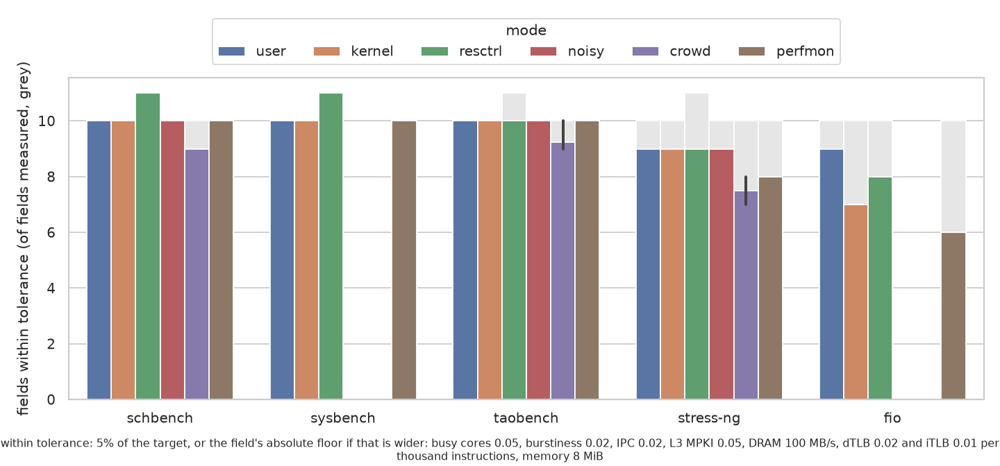

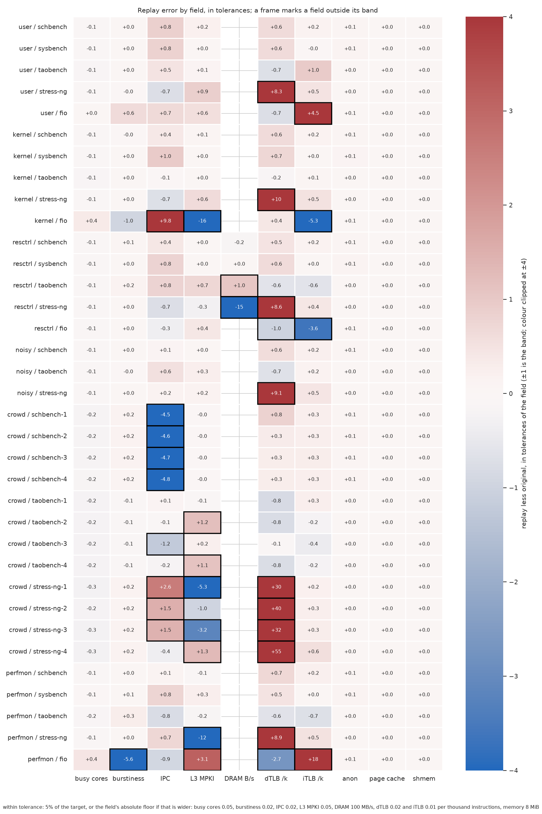

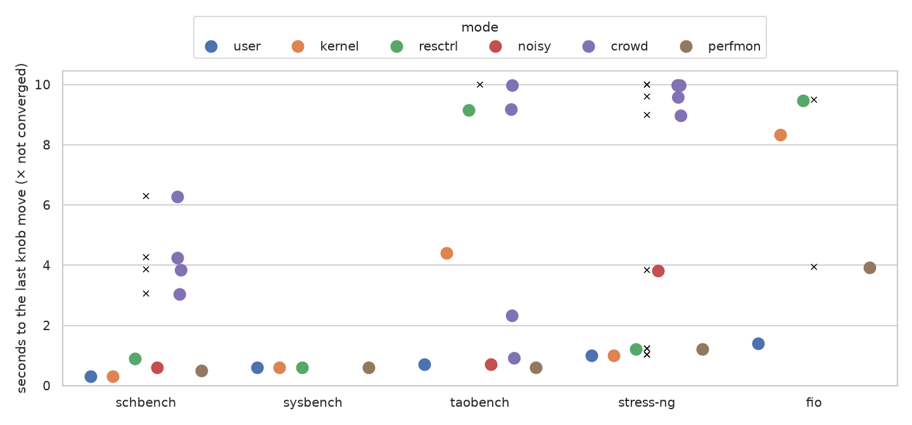

### `user`: unprivileged, as in a container

| benchmark | within | fit | what missed |
| --- | --- | --- | --- |
| schbench | 10 of 10 | 2 passes, 0.3 s | nothing |
| sysbench | 10 of 10 | 5 passes, 0.6 s | nothing |
| taobench | 10 of 10 | 6 passes, 0.7 s | nothing |
| stress-ng | 9 of 10 | 9 passes, 1.0 s | dTLB 0.17 vs 0.0058 |
| fio | 9 of 10 | 13 passes, 1.4 s | iTLB 0.070 vs 0.025 |

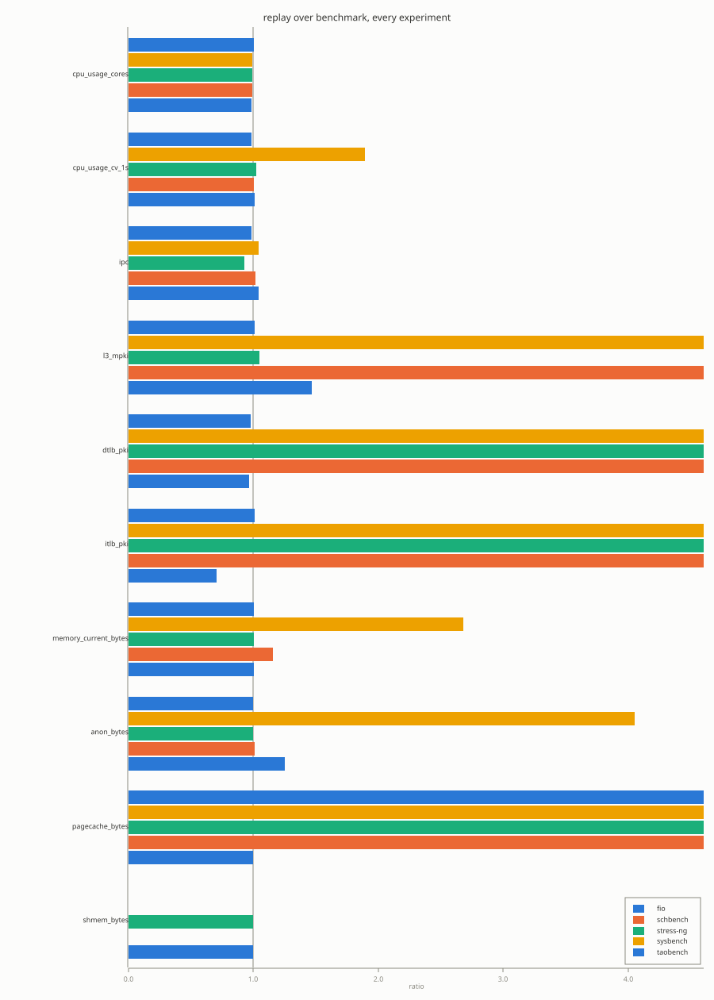

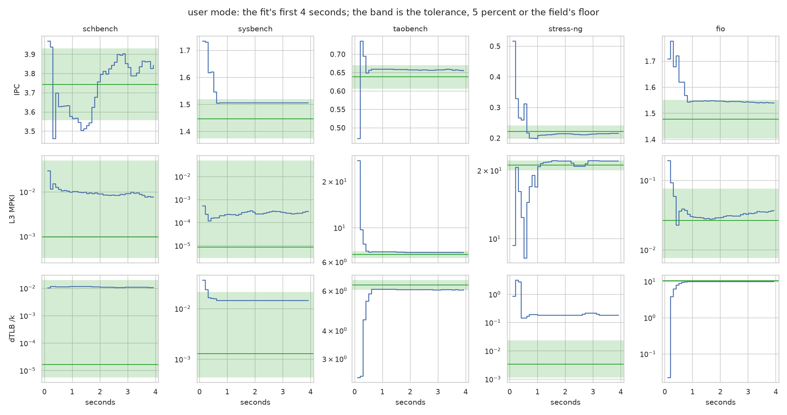

### `kernel`: both recordings count kernel mode

| benchmark | within | fit | what missed |
| --- | --- | --- | --- |
| schbench | 10 of 10 | 2 passes, 0.3 s | nothing |
| sysbench | 10 of 10 | 5 passes, 0.6 s | nothing |
| taobench | 10 of 10 | 8 passes, 4.4 s | nothing |
| stress-ng | 9 of 10 | 9 passes, 1.0 s | dTLB 0.22 vs 0.011 |
| fio | 7 of 10 | 45 passes, 8.3 s | IPC 2.12 vs 1.42, MPKI 0.39 vs 2.17, iTLB 0.010 vs 0.063 |

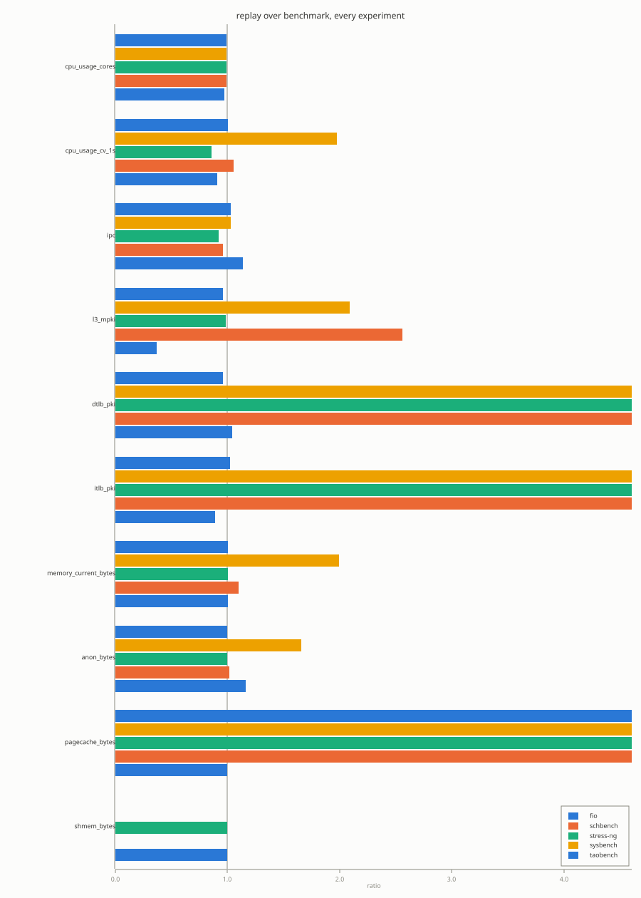

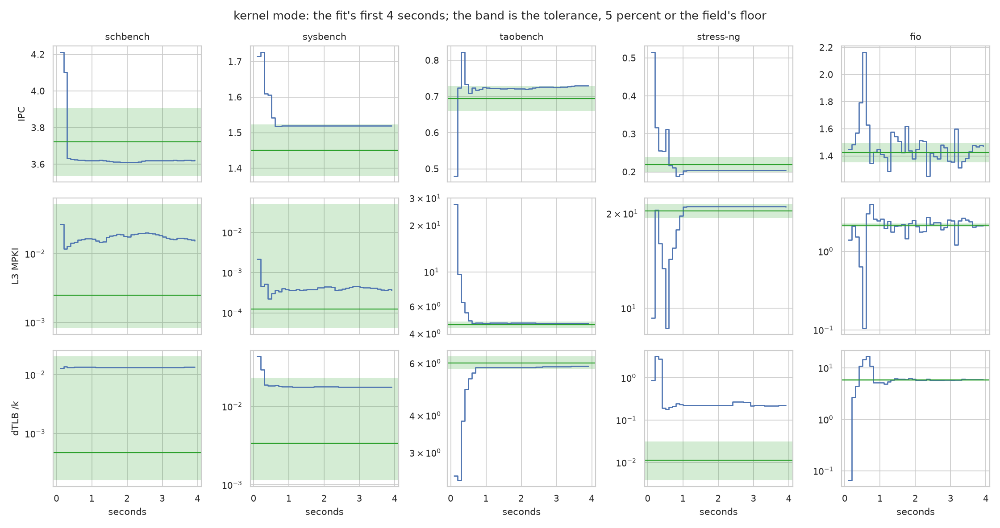

### `resctrl`: DRAM bandwidth measured on both sides

| benchmark | within | fit | what missed |
| --- | --- | --- | --- |
| schbench | 11 of 11 | 7 passes, 0.9 s | nothing; bandwidth 57 MB/s vs 73, within its floor |
| sysbench | 11 of 11 | 5 passes, 0.6 s | nothing; bandwidth within its floor |
| taobench | 10 of 11 | 19 passes, 9.2 s | bandwidth 10.1 vs 9.6 GB/s, 5 percent over |
| stress-ng | 9 of 11 | 11 passes, 1.2 s | dTLB 0.18 vs 0.0033, bandwidth 16 vs 70 GB/s |
| fio | 8 of 10 | held, 36 passes by 9.5 s | dTLB 8.2 vs 8.7, iTLB 0.016 vs 0.053; the replay's bandwidth had no reading |

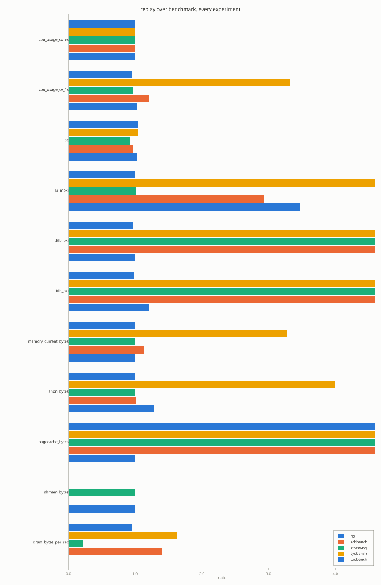

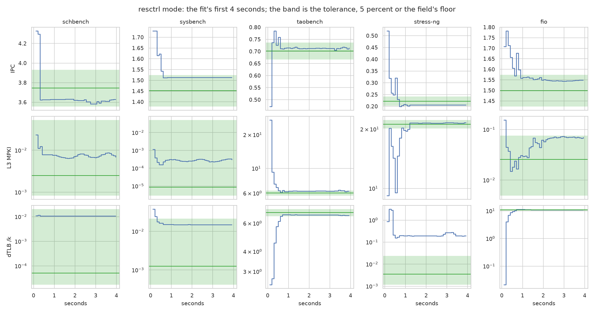

### `noisy`: three profiles at once, each in its own scope

| benchmark | within | fit | what missed |
| --- | --- | --- | --- |
| schbench | 10 of 10 | 5 passes, 0.6 s | nothing |
| taobench | 10 of 10 | 6 passes, 0.7 s | nothing |
| stress-ng | 9 of 10 | 15 passes, 3.8 s | dTLB 0.19 vs 0.0058 |

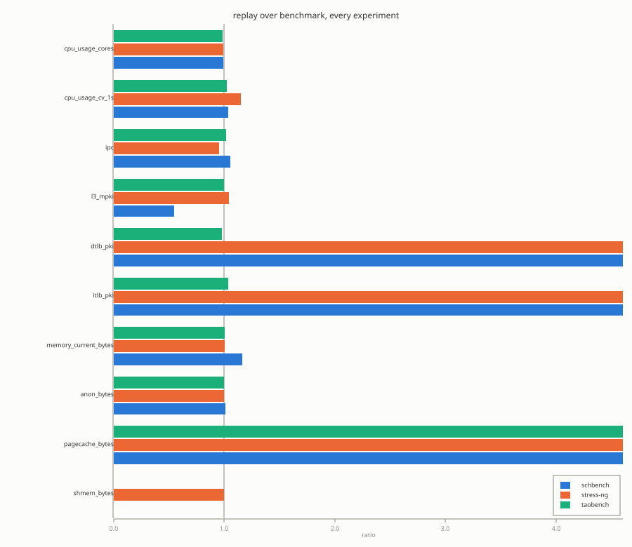

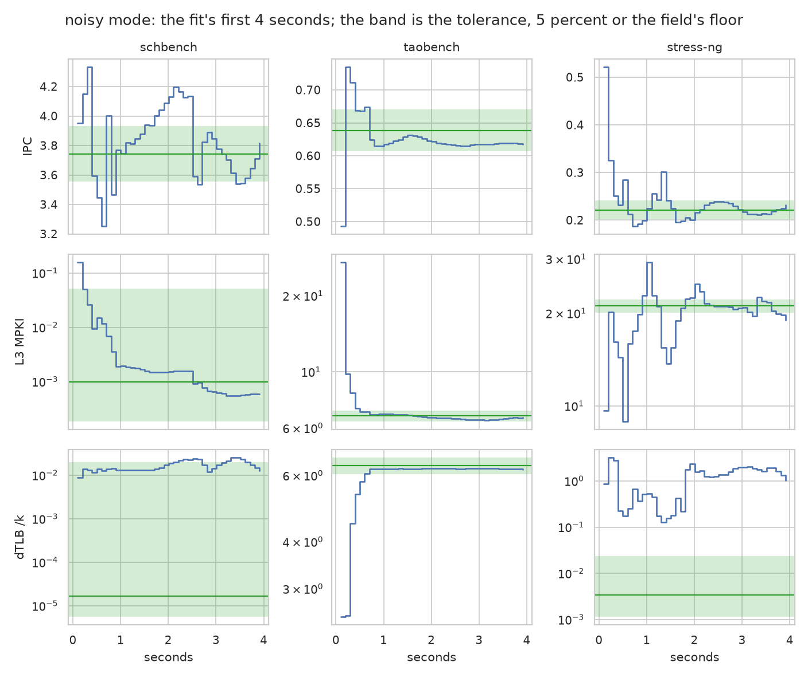

### `perfmon`: `CAP_PERFMON`, L3 misses from the L3 PMU

| benchmark | within | fit | what missed |
| --- | --- | --- | --- |
| schbench | 10 of 10 | 4 passes, 0.5 s | nothing |
| sysbench | 10 of 10 | 5 passes, 0.6 s | nothing |
| taobench | 10 of 10 | 5 passes, 0.6 s | nothing |
| stress-ng | 8 of 10 | held, 9 passes by 1.2 s | MPKI 38 vs 95, dTLB |
| fio | 6 of 10 | held, 36 passes by 3.9 s | burstiness 1.1 vs 1.6, MPKI 17.6 vs 15.2, dTLB 5.4 vs 6.2, iTLB 0.24 vs 0.056 |

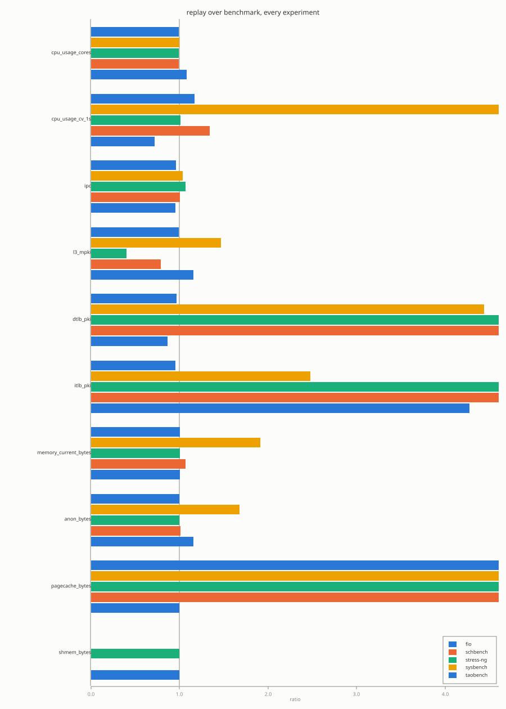

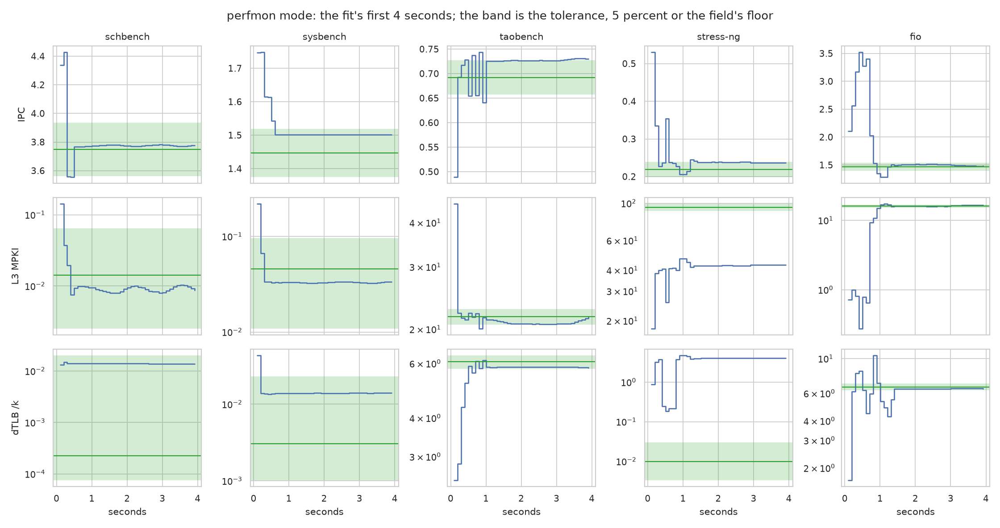

### `crowd`: four copies of three profiles at once, twelve instances

| profile | copies within | fit | what missed |
| --- | --- | --- | --- |
| schbench | 9 of 10, all four | 7 to 8 passes, 3.0 to 6.3 s | IPC 2.83 to 2.87 vs 3.71 |
| stress-ng | 7 to 8 of 10 | 27 to 49 passes, still moving at 10 s | dTLB; IPC 0.25 to 0.27 vs 0.22 on three copies; MPKI 15 to 22 vs 20.5 on three |
| taobench | 9 to 10 of 10 | 7 to 22 passes, 0.9 to 10 s | MPKI 6.4 vs 6.1 on two copies, IPC 0.66 vs 0.70 on one |

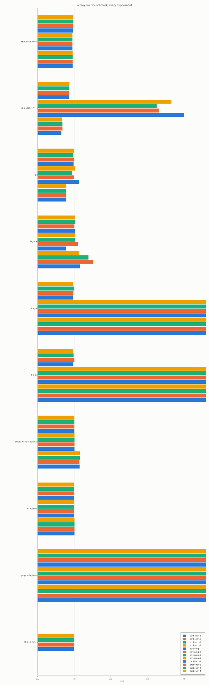

### `disturbed`: a live fit while stress-ng comes and goes

Each profile fitted live for 100 s; `stress-ng --vm 4 --vm-bytes 1G`
ran beside it from 35 s to 65 s. The three columns are the three 25 s
recordings: 10 to 35 s, 40 to 65 s and 70 to 95 s. "Moved" counts
the knob moves within fifteen seconds of the neighbour's arrival and
of its departure.

| profile | alone | beside | after | moved on arrival, on departure |
| --- | --- | --- | --- | --- |
| schbench | 10 of 10 | 9 of 10: IPC 3.2 vs 3.71 | 10 of 10 | 6 passes from 1.3 s after; 2 passes from 1.3 s after |
| stress-ng | 9 of 10: dTLB floor | 7 of 10: IPC 0.06 vs 0.22, MPKI 24.8 vs 20.5, dTLB | 9 of 10: dTLB floor | 61 passes over 8 s, two budgets, then the closest pass held; none needed after |
| taobench | 10 of 10 | 8 of 10: cores 2.93 vs 3.09, IPC 0.66 vs 0.70 | 10 of 10 | 31 passes from 0.9 s after; 43 passes from 0.8 s after |

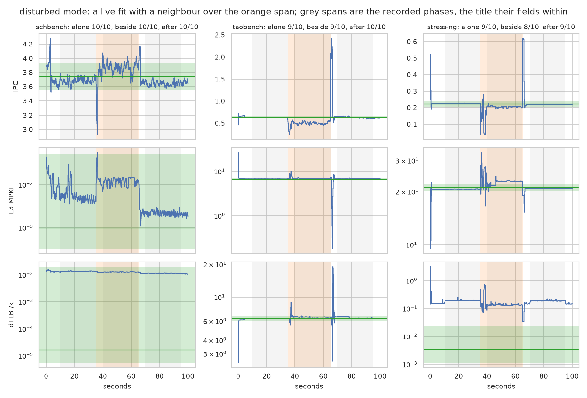

## Results on an Apple M2 Ultra

Run on 2026-10-18 on the Apple M2 Ultra described in `docs/status.md`,
16 Avalanche P cores and 8 Blizzard E cores under Asahi Linux 7.1
with 16 KiB pages, the same harness and settings. The host's PMU
counts L3 misses on the P cores only and none a prefetcher brought in,
so a sequential writer records next to none at any bandwidth, as
stress-ng does here; there is no resctrl, so the `resctrl` mode did
not run and bandwidth is modelled on every row. The data is under
`docs/experiments/apple-m2-ultra/<mode>/`, the figures under
`docs/experiments/apple-m2-ultra/plots/`.

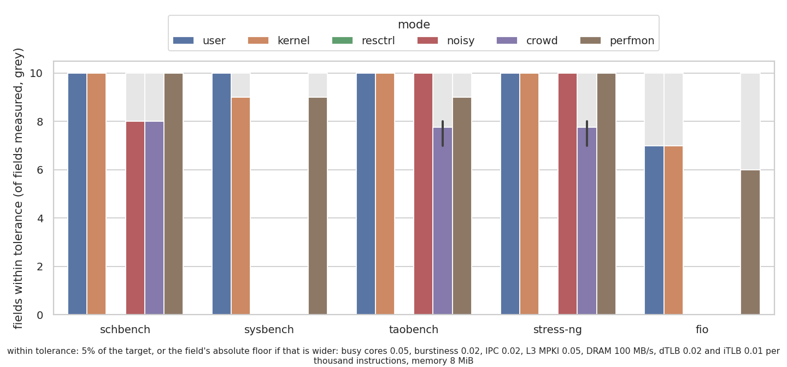

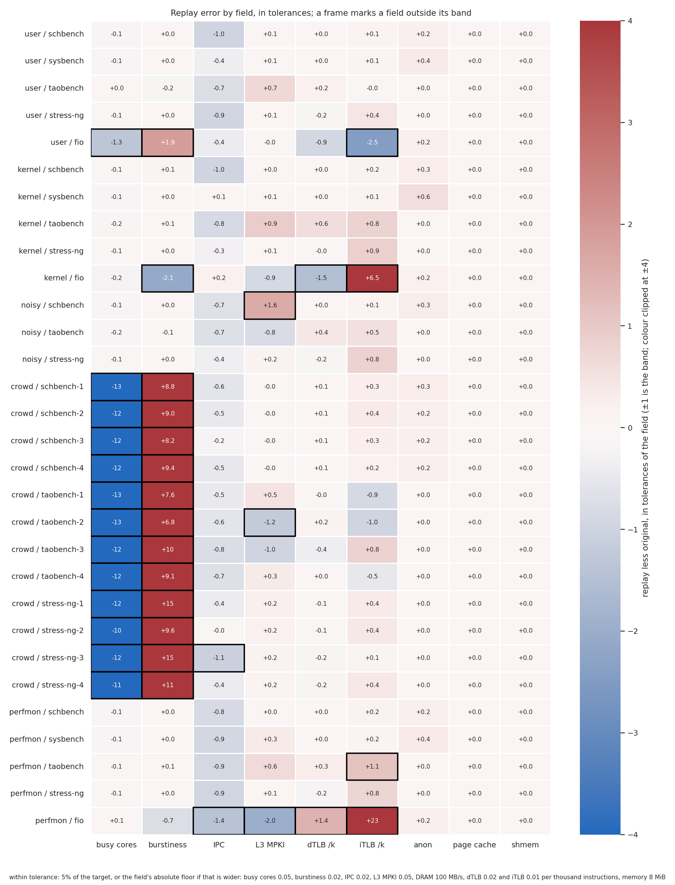

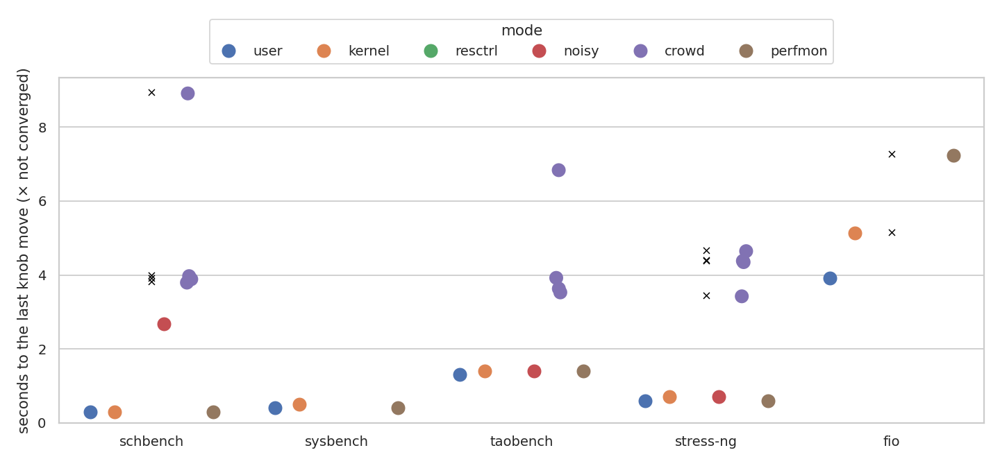

### `user`

| benchmark | within | fit | what missed |
| --- | --- | --- | --- |
| schbench | 10 of 10 | 2 passes, 0.3 s | nothing |
| sysbench | 10 of 10 | 3 passes, 0.4 s | nothing |
| taobench | 10 of 10 | 12 passes, 1.3 s | nothing |
| stress-ng | 10 of 10 | 5 passes, 0.6 s | nothing |
| fio | 7 of 10 | 24 passes, 3.9 s | cores 0.139 vs 0.204, burstiness 1.58 vs 1.44, iTLB 0.538 vs 0.613 |

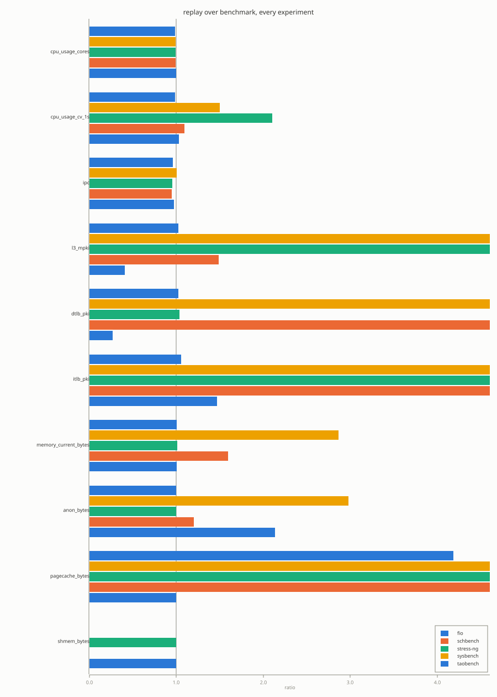

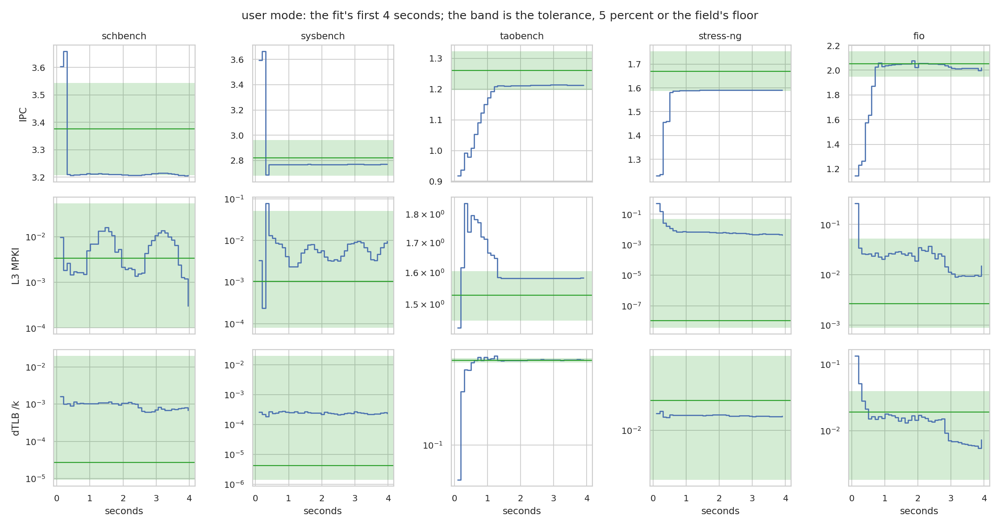

### `kernel`: both recordings count kernel mode

| benchmark | within | fit | what missed |
| --- | --- | --- | --- |
| schbench | 10 of 10 | 2 passes, 0.3 s | nothing |
| sysbench | 9 of 10 | 4 passes, 0.5 s | memory 12.4 MiB vs 2.8 MiB |
| taobench | 10 of 10 | 13 passes, 1.4 s | nothing |
| stress-ng | 10 of 10 | 6 passes, 0.7 s | nothing |
| fio | 7 of 10 | held, 36 passes by 5.0 s | burstiness 1.07 vs 1.20, dTLB 0.329 vs 0.360, iTLB 1.15 vs 0.866 |

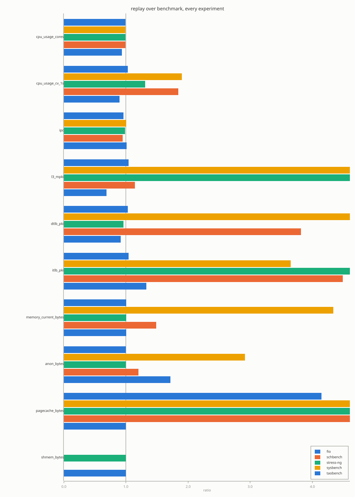

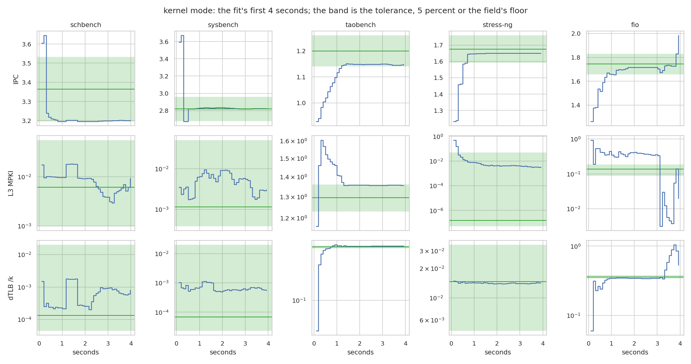

### `perfmon`: `CAP_PERFMON`

| benchmark | within | fit | what missed |
| --- | --- | --- | --- |
| schbench | 10 of 10 | 2 passes, 0.3 s | nothing |
| sysbench | 9 of 10 | 3 passes, 0.4 s | memory 15.6 MiB vs 5.9 MiB |
| taobench | 9 of 10 | 13 passes, 1.4 s | iTLB 3.59 vs 3.40 |
| stress-ng | 10 of 10 | 5 passes, 0.6 s | nothing |
| fio | 6 of 10 | 21 passes, still moving at 10 s | IPC 1.61 vs 1.73, MPKI 0.016 vs 0.115, dTLB 0.387 vs 0.358, iTLB 1.91 vs 0.895 |

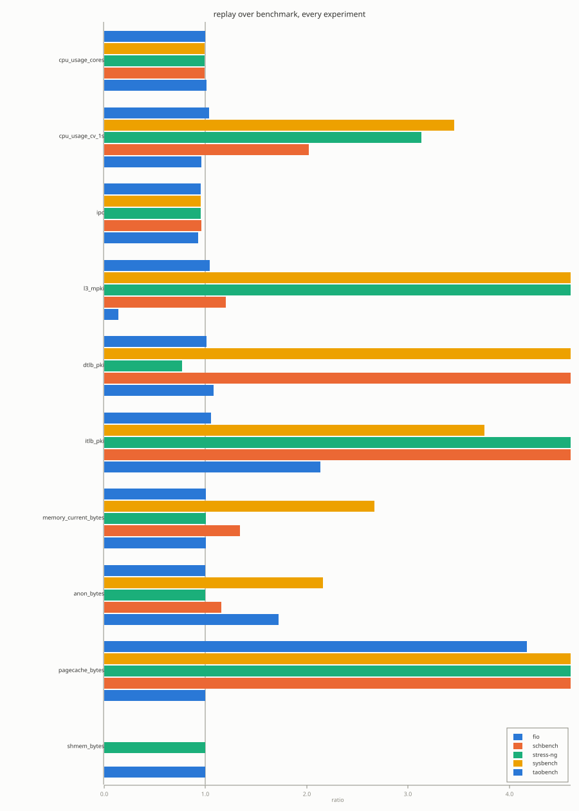

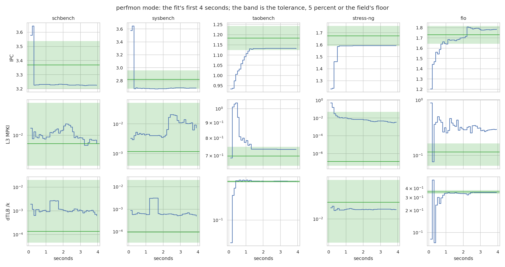

### `noisy`: three profiles at once

| benchmark | within | fit | what missed |
| --- | --- | --- | --- |
| schbench | 8 of 10 | 3 passes, 2.7 s | MPKI 0.084 vs 0.0034, memory 27.6 MiB vs 19.0 MiB |
| taobench | 10 of 10 | 13 passes, 1.4 s | nothing |
| stress-ng | 10 of 10 | 6 passes, 0.7 s | nothing |

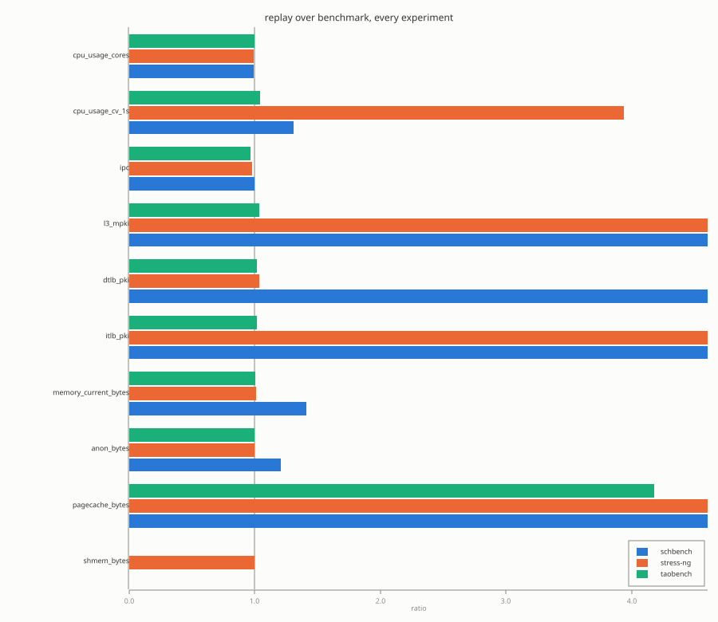

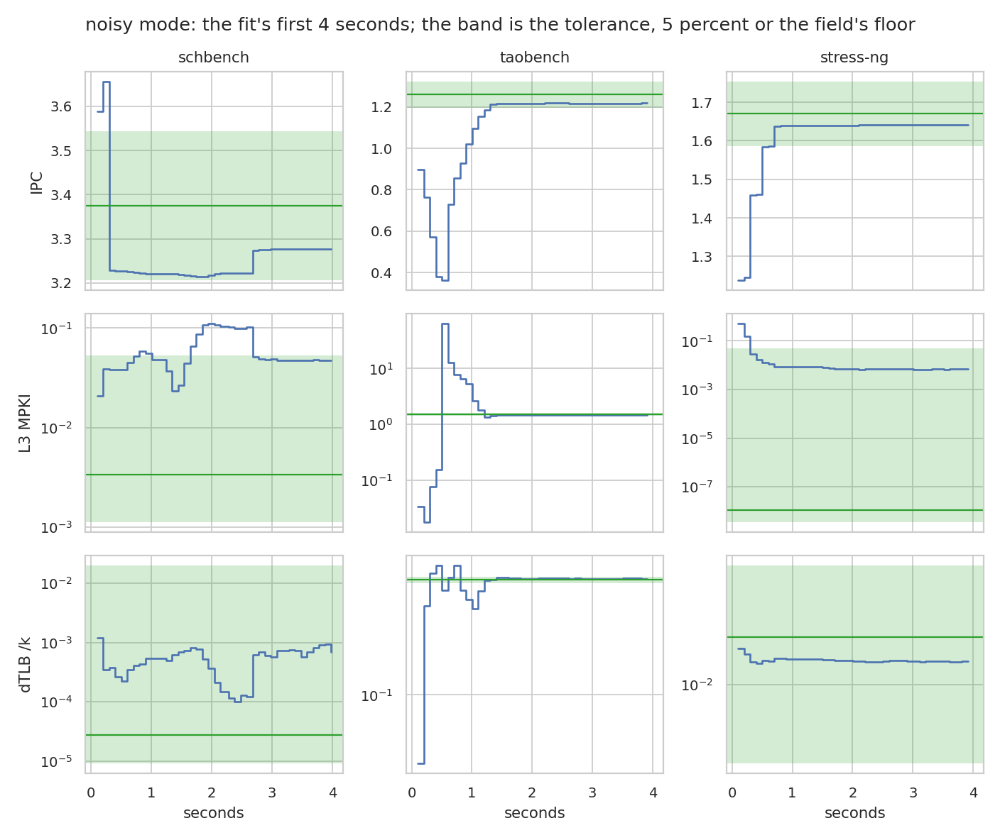

### `crowd`: four copies of three profiles, twelve instances on twenty-four cores

The twelve instances ask for 61 busy cores of this host's 24, where
the Zen 4 host has 64, so the mode here fills the host two and a half
times over and every copy gets its fair share of the cores and the
burstiness of the contention.

| benchmark | within | fit | what missed |
| --- | --- | --- | --- |
| schbench-1 | 8 of 10 | 6 passes, still moving at 10 s | cores 2.85 vs 7.98, burstiness 0.177 vs 0.0009 |
| schbench-2 | 8 of 10 | 6 passes, still moving at 10 s | cores 3.24 vs 7.98, burstiness 0.180 vs 0.0009 |
| schbench-3 | 8 of 10 | 6 passes, still moving at 10 s | cores 3.00 vs 7.98, burstiness 0.164 vs 0.0009 |
| schbench-4 | 8 of 10 | 6 passes, still moving at 10 s | cores 3.01 vs 7.98, burstiness 0.189 vs 0.0009 |
| taobench-1 | 8 of 10 | 16 passes, 3.5 s | cores 1.23 vs 3.27, burstiness 0.200 vs 0.049 |
| taobench-2 | 7 of 10 | 19 passes, 3.9 s | cores 1.16 vs 3.27, burstiness 0.184 vs 0.049, MPKI 1.44 vs 1.53 |
| taobench-3 | 8 of 10 | 53 passes, 6.8 s | cores 1.28 vs 3.27, burstiness 0.252 vs 0.049 |
| taobench-4 | 8 of 10 | 14 passes, 3.6 s | cores 1.25 vs 3.27, burstiness 0.231 vs 0.049 |
| stress-ng-1 | 8 of 10 | 15 passes, still moving at 10 s | cores 1.51 vs 3.98, burstiness 0.291 vs 0.0002 |
| stress-ng-2 | 8 of 10 | 16 passes, still moving at 10 s | cores 1.92 vs 3.98, burstiness 0.192 vs 0.0002 |
| stress-ng-3 | 7 of 10 | 15 passes, still moving at 10 s | cores 1.57 vs 3.98, burstiness 0.296 vs 0.0002, IPC 1.58 vs 1.67 |
| stress-ng-4 | 8 of 10 | 15 passes, still moving at 10 s | cores 1.87 vs 3.98, burstiness 0.228 vs 0.0002 |

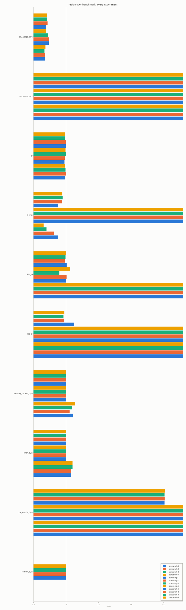

### `disturbed`: a live fit while stress-ng comes and goes

| profile | alone | beside | after |
| --- | --- | --- | --- |
| schbench | 9 of 10: memory 30.5 MiB vs 19.0 MiB | 10 of 10 | 10 of 10 |
| taobench | 9 of 10: burstiness 0.025 vs 0.049 | 10 of 10 | 10 of 10 |
| stress-ng | 10 of 10 | 10 of 10 | 10 of 10 |

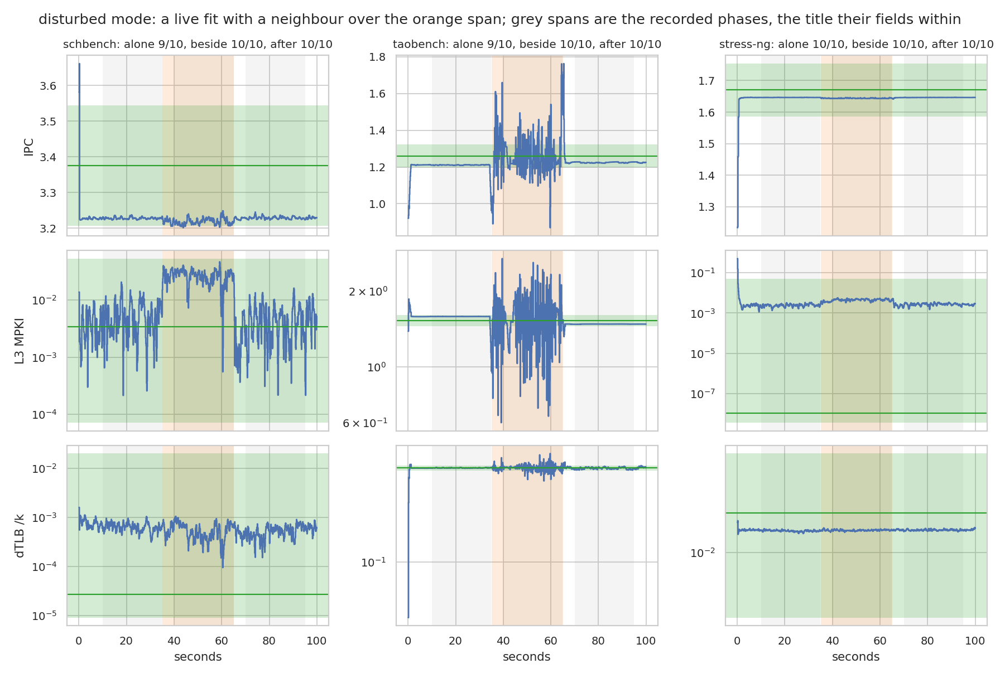

What the M2 Ultra adds to the reading below:

- **The converging profiles converge as fast as on Zen 4**, schbench
  and sysbench in 0.3 to 0.5 s and TaoBench in 1.3 to 1.4 s in every
  mode, and land every field within in user and kernel mode. stress-ng
  joins them here: with its sequential writes prefetched and the miss
  event counting none of them, its profile asks for an IPC of 1.7 to
  2.0 at zero misses, which is compute, and the fit lands it in 0.6 to
  0.7 s once the ops rule aimed inside the floor rather than at zero.
- **fio stays the hard one**, 6 to 7 of 10 in every mode: one thread
  for its 0.2 cores with a burstiness of 1.4, judged one plateau at a
  time (`docs/status.md`, open item 3). In user mode the hold ran at
  0.14 cores against 0.20 and an iTLB rate 12 percent short; with the
  kernel counted its dTLB and iTLB rates, which here are the demand
  L1 misses, come from the kernel's copies and the replay's stubs
  cannot follow them plateau by plateau.
- **Memory is the tool's own.** A process as small as sysbench, 3 MiB,
  is under the replay's baseline, 12 to 16 MiB with 16 KiB pages, so
  the memory total misses by more than the 8 MiB floor in the kernel
  and perfmon modes; the components are within.
- **Neighbours cost what they cost.** Beside two other profiles
  schbench's MPKI reads 0.084 against 0.0034, the neighbours' lines in
  the shared system cache, where its own fit was within; TaoBench and
  stress-ng are within on every field. With twelve instances on
  twenty-four cores every copy runs at a third to a half of its busy
  cores and the ratios mostly hold, 7 to 8 of 10 each. A neighbour
  arriving and leaving leaves every profile within on every field in
  the phases beside it and after.

## Reading the results

The comparison is between two recordings taken the same way, so it
measures the replay against the recorder, not against the replay's
own report. What the five modes say:

- **Every converging profile fits in under a second.** schbench,
  sysbench and TaoBench converge in 0.3 to 0.9 s in every mode, with
  two neighbours or without, and land every field within tolerance
  but TaoBench's bandwidth under resctrl, 5 percent over;
  TaoBench, the farthest from the first guess, takes six passes where
  it took ten the day before, since the sparse visits now correct by
  the dTLB events they are short rather than by ratio. stress-ng
  reaches everything but its dTLB rate by its tenth pass, 1.0 s.
- **stress-ng meets everything but its dTLB rate**, which is a floor
  of this host's hardware: under the L2-hit definition the L1 dTLB
  reloads on about 1.4 percent of hugepage touches whatever the set,
  and a memory-bound target at low IPC needs dependent misses, each
  in a page of its own. A sequential walk would meet the rate and
  lift IPC to 0.74 against 0.22. Its 70 GB/s is a streaming store's
  bandwidth, several times what its counted misses move; random
  64-byte lines reach 15 GB/s here. The fit never converges, since
  the dTLB rate is always out, so it stays bound by its pass budget
  and nudges when a pooled MPKI crosses the edge of its band, which is
  the 15 passes with neighbours. See `docs/design.md` section 5.1 and
  `docs/status.md`.
- **fio is a bursty, kernel-bound process seen one plateau at a
  time.** Its duty cycle holds each of twenty factors for four
  seconds, and its rates per instruction differ several times over
  between a quiet plateau, where every wakeup refetches a cold cache
  and TLB, and a busy one. In user mode the fit converged in 1.4 s
  inside one plateau and nine fields held over the 135 s hold; the
  iTLB rate, which the stub calls set for that plateau, averaged
  three times higher over all of them. In kernel mode the profile
  acquires the kernel's own misses, 2.2 per thousand instructions
  from page-cache copies, and the fit re-fits at each plateau and
  does not settle: 45 passes, its last at 8.3 s, and the hold ran at
  the IPC of the plateau it ended in. In resctrl mode, with one
  thread for its 0.26 cores, busy cores and burstiness land within a
  percent and the replay's bandwidth has no reading.
- **The L3 PMU changes the question.** With `CAP_PERFMON` the
  recorder counts every L3 miss, prefetched lines included, so
  stress-ng's profile reads 95 misses per thousand instructions where
  the proxy saw 21, and fio's 15 where it saw 2. A miss every ten
  instructions needs the prefetched walk, which lifts IPC as it lifts
  MPKI; the fitter sees the two rules pull the run length against each
  other, freezes it by the ninth pass and holds the closest pass as
  the compromise, 38 MPKI at the target's IPC, where it used to cycle
  through its whole budget. The compute-bound profiles and TaoBench
  are unaffected: TaoBench's 20 MPKI under the L3 PMU is met in five
  passes.
- **Measured bandwidth** lands within its floor for the compute-bound
  profiles and 5 percent over for TaoBench, 10.1 against 9.6 GB/s:
  the monitoring counters on this host wander (`docs/status.md`,
  open item 1), the converged fit re-fit at 9 s after a second of
  readings out, and the hold ran the knobs of that re-fit. stress-ng's
  70 GB/s is beyond what its counted misses move. Where bandwidth is
  modelled, for want of resctrl, it is reported and not fitted.
- **Neighbours cost nothing measurable here.** With three replays
  sharing the caches and the memory bus, schbench and TaoBench land 10
  of 10 in 0.6 and 0.7 s, and stress-ng's IPC and MPKI land within one
  percent over the hold, where the day before they had drifted 20
  percent: the run-length rule no longer chases a pooled MPKI short
  by noise to its cap.

- **A full host costs what the host costs.** With twelve instances
  on sixty-four hardware threads, schbench's replays sit at IPC 2.85
  against 3.71 on every copy: eight threads at that IPC need cores to
  themselves, and with sixty busy threads each shares a core with a
  sibling. stress-ng's four copies want sixteen gigabytes a second
  each from a bus the other eight instances use too, and their IPC
  and MPKI land ten to twenty percent off; TaoBench's copies are
  within or a few percent out. Memory is within on every instance,
  now that the generator measures its own cgroup.
- **A neighbour arriving moves the fit within about a second, and a
  neighbour leaving within about a second too**, after which every
  profile is back within tolerance on every field it can reach.
  While a memory-bound neighbour is there, what the replay cannot
  have is what the neighbour takes: schbench's IPC on a shared core,
  stress-ng's IPC on a saturated bus, and TaoBench's IPC by five
  percent; stress-ng's fit spent two budgets of passes against that
  before holding, which is work left to do.

What the plots cannot show is anything outside the observables: the
replay has no syscalls, no I/O and no wakeups, however close the
numbers are.
